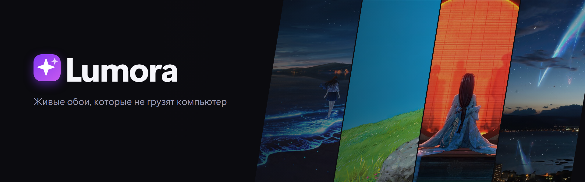
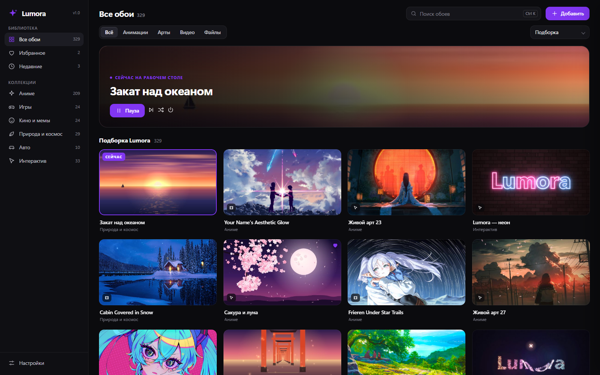
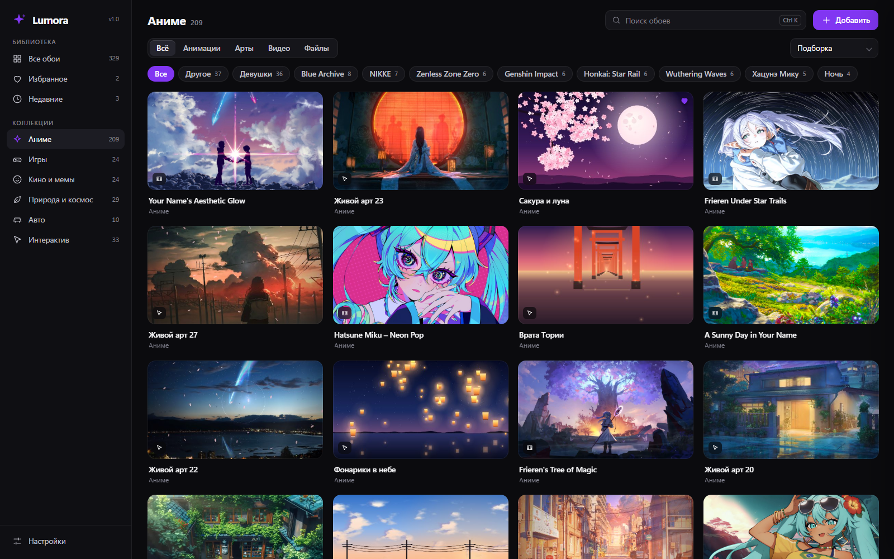
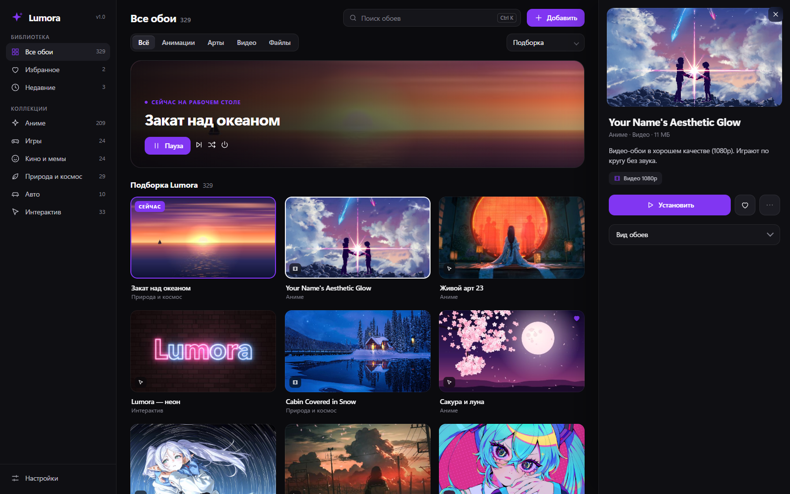
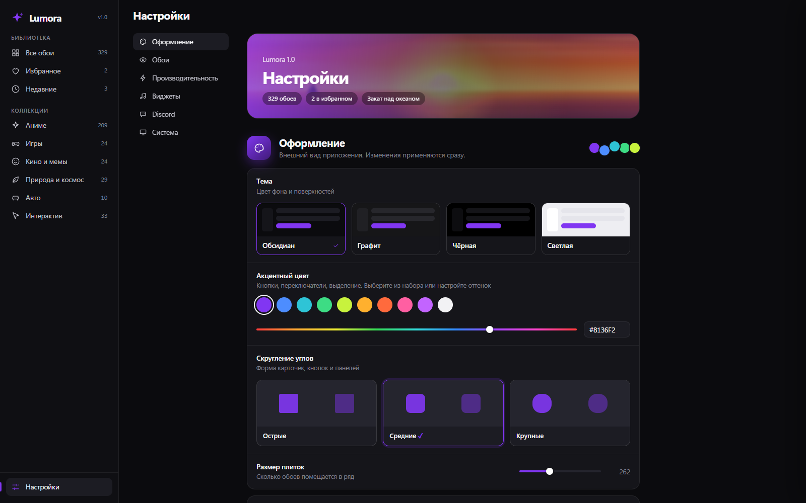
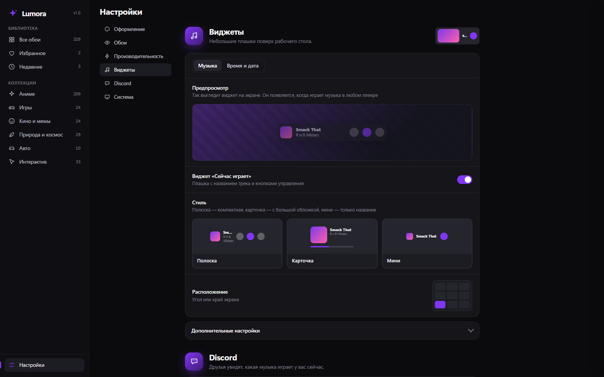
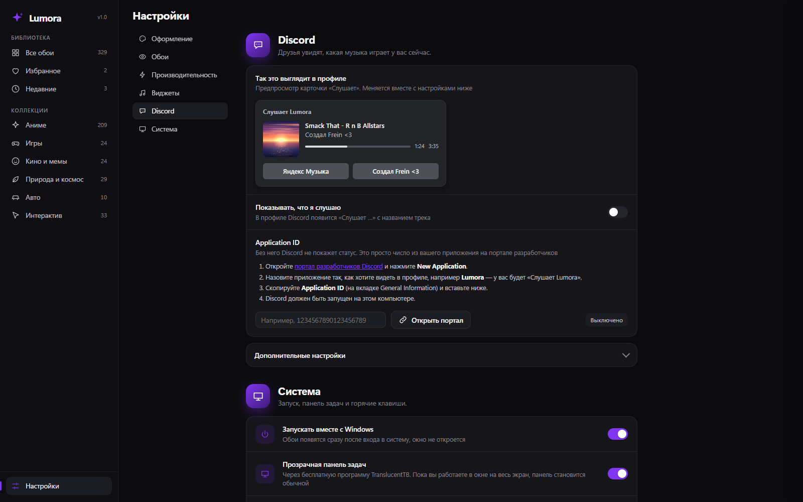
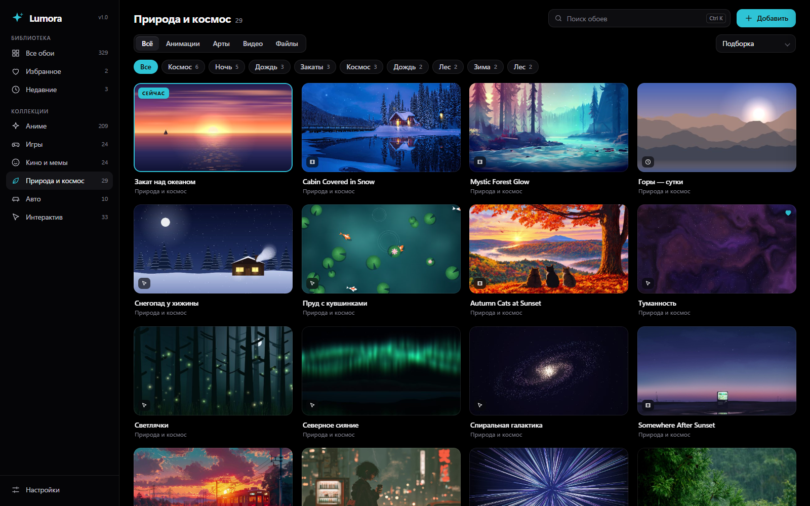

<div align="center">



# Lumora

**Живые обои для Windows, которые не грузят компьютер.**
Видео 1080p, оживающие аниме-арты и анимации на рабочем столе. Музыка, виджеты времени и погоды, статус в Discord.

[](#установка)
[](LICENSE)
[](#установка)

[Скачать](../../releases/latest) · [Возможности](#возможности) · [Скриншоты](#скриншоты) · [Коллекции обоев](#коллекции-обоев) · [Сборка](#сборка-из-исходников)

</div>

---

## Что это

Lumora ставит живую картинку **под значки рабочего стола**: анимацию на HTML/WebGL, видео, GIF или аниме-арт, который двигается за курсором и сыпет частицами. Приложение живёт в трее, не мешает работе и **почти ничего не потребляет**, а когда рабочий стол закрыт окнами — обои полностью засыпают.

Сделано на C# (WinForms) и WebView2. Интерфейс управления — отдельная HTML-страница, поэтому он лёгкий и красивый. Установка без прав администратора.

## Возможности

### Обои
- **56 встроенных анимаций:** космос, природа, аниме-сцены, часы, музыкальные визуализаторы, интерактив. Часть реагирует на курсор и клики, часть синхронизируется с музыкой, часть показывает время и дату.
- **«Живые арты».** Любая картинка оживает: плавно «дышит», следует за курсором, поверх падают частицы (искры, лепестки, снег, угольки, дождь, боке) и пролетает блик. Клик пускает круг света.
- **Видео и GIF.** Любое видео проигрывается по кругу без звука (или со звуком и регулировкой громкости), с настройкой скорости и режима «заполнить / вписать / растянуть».
- **Свои файлы:** перетащите в окно картинки, GIF, видео, HTML-страницы и обои в формате Lively.
- **Вид обоев:** яркость, контраст, насыщенность, оттенок, размытие и затемнение. Для всех обоев сразу или для каждых отдельно, с живым предпросмотром.
- **Автосмена:** слайд-шоу из всей библиотеки, избранного, видео, анимаций или артов; по порядку или вперемешку; от 1 минуты до 3 часов.

### Библиотека
- Поиск (<kbd>Ctrl</kbd>+<kbd>K</kbd>), коллекции, теги, фильтр по типу, сортировка, избранное, недавние.
- Подборка красивых обоев на первой странице.
- Видео проигрываются прямо на плитке при наведении.

### Музыка
- **Музыкальные обои:** эквалайзер, обложка и название трека из любого плеера (Spotify, Яндекс Музыка, браузер, VLC…).
- **Виджет «Сейчас играет»:** три стиля, девять положений, размер, прозрачность, цвет фона, полоса прогресса с перемоткой, громкость колесом мыши.
- **Мини-плеер** в самом приложении с кнопками «назад / пауза / вперёд».

### Виджет времени
Цифровые, крупные, компактная строка или аналоговые часы. Шесть шрифтов, любой цвет и подложка, тень, 12/24 часа, секунды, мигающее двоеточие, пять форматов даты, номер недели, заряд батареи и **погода** по названию города (Open-Meteo, без регистрации). Можно перетаскивать мышью.

### Discord
Rich Presence: в профиле «Слушает …» с названием, исполнителем, обложкой (подбирается автоматически), полосой времени и кнопками.

### Оформление приложения
Четыре темы (Обсидиан, Графит, Чёрная, Светлая), любой акцентный цвет, три степени скругления, масштаб интерфейса, размер плиток. По умолчанию — «Обсидиан» с акцентом `#8136f2`.

### Прочее
- Прозрачная панель задач (через [TranslucentTB](https://github.com/TranslucentTB/TranslucentTB), ставится автоматически). Когда вы в окне на весь экран, панель снова обычная.
- Горячие клавиши: <kbd>Ctrl</kbd>+<kbd>Alt</kbd>+<kbd>→</kbd> / <kbd>←</kbd> / <kbd>R</kbd> / <kbd>P</kbd> / <kbd>L</kbd>.
- Автозапуск с Windows, tray-меню, один экземпляр приложения.
- Пауза при блокировке экрана и во сне, экономия на батарее, низкий приоритет процесса.

## Скриншоты

| | |
|---|---|
|  |  |
| Главная: подборка и текущие обои | Коллекция «Аниме» с тегами |
|  |  |
| Карточка обоев | Настройки с предпросмотром |
|  |  |
| Виджеты музыки и времени | Discord: так выглядит профиль |
|  | |
| Чёрная тема, бирюзовый акцент | |

## Установка

1. Скачайте **`Lumora-Setup.exe`** со страницы [Releases](../../releases/latest).
2. Запустите. Права администратора не нужны. Выберите папку (по умолчанию `%LOCALAPPDATA%\Programs\Lumora`) и галочки: ярлык на рабочем столе, запуск с Windows, запуск после установки.
3. Откройте Lumora. По умолчанию на рабочем столе появится «Lumora — частицы».

Тихая установка: `Lumora-Setup.exe /S`. Удаление: «Параметры → Приложения» или `Uninstall.exe` в папке программы.

**Требования:** Windows 10 или 11 (64 бита), [Microsoft Edge WebView2 Runtime](https://developer.microsoft.com/microsoft-edge/webview2/) (в Windows 11 уже есть).

> Установщик не подписан цифровой подписью, поэтому при первом запуске Windows SmartScreen может показать предупреждение «Неопознанный издатель». Нажмите «Подробнее → Выполнить в любом случае». Контрольные суммы лежат в релизе (`SHA256SUMS.txt`).

## Коллекции обоев

Сама программа лёгкая и содержит только встроенные анимации. **Аниме-арты и видео-обои вынесены в отдельные установщики** — в репозиторий [Lumora Packs](../../../Lumora-Packs): аниме-арты (50 шт.) и около 220 видео-обоев 1080p. Установщик кладёт файлы прямо в библиотеку Lumora.

> ⚠️ Арты и видео в коллекциях **сделаны не автором Lumora** и принадлежат своим создателям. Они приложены только как пример того, что можно найти в интернете и поставить на рабочий стол. Используйте для себя и не перепродавайте. Если вы автор и хотите убрать работу — напишите, её удалят.

Свои обои проще всего добавить кнопкой **«Добавить»** или перетаскиванием файлов в окно.

## Быстрый старт

| Что сделать | Как |
|---|---|
| Поставить обои | Двойной клик по плитке или кнопка «Установить» |
| В избранное | Сердечко на плитке или <kbd>F</kbd> |
| Найти обои | <kbd>Ctrl</kbd>+<kbd>K</kbd> |
| Подкрутить яркость, цвет | Карточка обоев → «Вид обоев» |
| Включить виджет времени | Настройки → Виджеты → «Время и дата» |
| Статус в Discord | Настройки → Discord (нужен свой Application ID) |
| Меньше нагрузки | Настройки → Производительность → «Экономный» |

### Как включить Discord
1. Откройте [портал разработчиков](https://discord.com/developers/applications) → **New Application**, назовите его, например, `Lumora`.
2. Скопируйте **Application ID** из General Information.
3. В Lumora: Настройки → Discord → вставьте ID и включите переключатель. Discord должен быть запущен.

## Как это не нагружает компьютер

- Когда рабочий стол полностью закрыт окнами, браузерный движок приостанавливается — нагрузка ≈ 0.
- При блокировке экрана и во сне обои замирают.
- Звуковой анализатор и опрос плеера работают, только если нужны текущим обоям.
- Частота кадров от 15 до 60 и чёткость 50–150% настраиваются; пресеты «Экономный / Обычный / Максимум».
- Закрытое окно управления освобождает память целиком.

## Сборка из исходников

Нужны Windows 10/11, Node.js и Google Chrome (для превью). Компилятор C# встроенный в Windows.

```powershell
node tools/gen.js        # собирает builtin\*.html из src\engine.js и src\scenes\*.js
node tools/shoot.js      # проверка обоев в Chrome + превью (необязательно)
powershell -ExecutionPolicy Bypass -File build.ps1                    # сборка, установка в %LOCALAPPDATA%, ярлыки, автозапуск
powershell -ExecutionPolicy Bypass -File tools\make-installer.ps1     # dist\Lumora-Setup.exe
```

Дополнения: `tools\make-packs.ps1` собирает установщики коллекций из вашей библиотеки (`%LOCALAPPDATA%\LiveWall\Library`).
`tools\videos.js` — пример скрипта, который скачивает видео-обои для личного использования.

### Структура

| Путь | Что внутри |
|---|---|
| `Core.cs`, `App.cs`, `Wallpaper.cs`, `Studio.cs` | ядро: окно обоев под значками, пауза, трей, данные для интерфейса |
| `SettingsForm.cs` | окно управления (WebView2) |
| `Widget.cs`, `ClockWidget.cs`, `Discord.cs`, `Music.cs` | виджеты, Discord, звук и плеер |
| `ui/` | интерфейс (HTML/CSS/JS) |
| `src/engine.js`, `src/scenes/` | движок и сценарии обоев (генерируются в самостоятельные HTML) |
| `installer/Setup.cs` | установщик и установщик дополнений |
| `tools/` | генерация, проверка, замеры, сборка установщиков |

## Лицензия

Код Lumora — [MIT](LICENSE). WebView2 SDK принадлежит Microsoft и скачивается при сборке. Аниме-арты и видео из коллекций в лицензию не входят и принадлежат своим авторам.

---

<div align="center">Создал <b>Frein</b> ❤</div>
